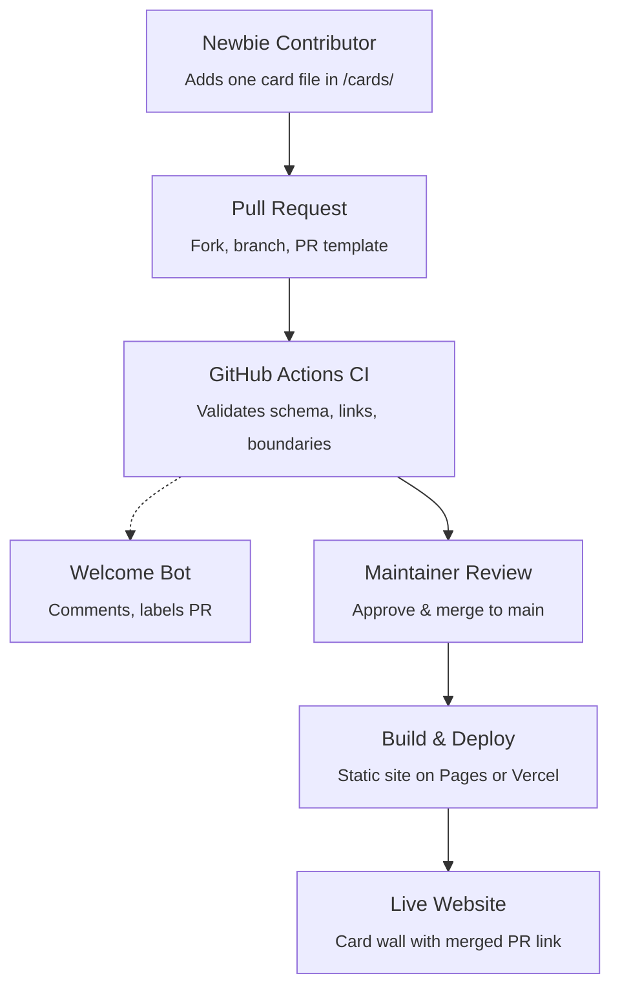

# 🌟 Open Source Contributor Wall

[](https://github.com/your-org/GitHub-Contri/actions/workflows/validate.yml)
[](CONTRIBUTING.md)
[](CONTRIBUTING.md)
[](LICENSE)

> A welcoming community profile card showcase designed specifically to help beginners make their very first open-source Pull Request.

---

## 💡 The Core Idea

A contributor's profile card is **just a single JSON file** in the repository. Opening a Pull Request to add that file is the contribution, and merging the PR automatically triggers a build and publishes the card onto the live website!



---

## 🛡️ Why This Architecture Works for Beginners

1. **One Contributor, One File (`cards/<username>.json`)**  
   Two people never edit the same file, so **merge conflicts**—the single most intimidating hurdle for first-time contributors—are completely avoided.
2. **No Database Needed**  
   Git itself is the database, and the PR git log is the transparent audit trail.
3. **Automated Schema & Safety Guardrails**  
   GitHub Actions CI verifies the JSON schema, avatar links, and ensures PRs only touch the contributor's own card.
4. **Permanent Attribution**  
   Each published card features a badge linking directly to the contributor's merged PR (e.g. `PR #42`).

---

## 📁 Repository Structure

```text
├── cards/                         # Contributor card files (one JSON file per person)
│   ├── janedoe.json
│   ├── alexrivera.json
│   ├── sarahchen.json
│   └── devmarcus.json
├── schema/
│   └── card.schema.json           # JSON Schema definition for validation
├── scripts/
│   ├── validate-cards.js          # Standalone card JSON validator
│   └── validate-pr.js             # CI boundary check (ensures PR touches only cards/)
├── site/                          # Vite + React + Tailwind CSS web application
│   ├── src/
│   │   ├── components/            # ContributorCard, FilterBar, Flowchart, Card Maker
│   │   ├── data/cards.js          # Dynamic build-time card importer (import.meta.glob)
│   │   ├── App.jsx
│   │   └── main.jsx
│   ├── package.json
│   └── vite.config.js
├── .github/
│   ├── workflows/
│   │   ├── validate.yml           # Runs validation & build test on PRs
│   │   ├── welcome.yml            # Greets first-timers & adds labels
│   │   └── deploy.yml             # Builds & deploys to GitHub Pages on merge
│   ├── PULL_REQUEST_TEMPLATE.md   # Helpful checklist for new contributors
│   └── CODEOWNERS                 # Auto-requests maintainer reviews
├── CONTRIBUTING.md                # 2-minute beginner-friendly walkthrough
└── package.json                   # Root workspace scripts
```

---

## 🗂️ The Contributor Card Data Model

Each card in `/cards/<your-github-username>.json` follows this format:

```json
{
  "name": "Jane Doe",
  "github": "janedoe",
  "avatar": "https://github.com/janedoe.png",
  "bio": "Learning web dev, building responsive UIs, and love cats!",
  "skills": ["HTML", "CSS", "Git", "React", "TailwindCSS"],
  "links": {
    "linkedin": "https://linkedin.com/in/janedoe",
    "portfolio": "https://janedoe.dev",
    "twitter": "https://twitter.com/janedoe"
  },
  "firstPR": "joined via PR #42",
  "joinedDate": "2026-01-15"
}
```

### Validation Rules (enforced by `schema/card.schema.json`):
- `name`: 2–50 characters.
- `github`: Valid GitHub handle matching the filename (`cards/<github>.json`).
- `avatar`: Valid HTTPS URL (defaults to `https://github.com/<username>.png`).
- `bio`: 5–180 characters.
- `skills`: 1–12 distinct technology tags.
- `links`: Allowed keys are `portfolio`, `linkedin`, `twitter`, `blog`, `youtube` (must be HTTPS).

---

## 🚀 Quick Start (Local Development)

### Prerequisites
- Node.js 18+ installed

### 1. Validate cards
```bash
npm run validate
```

### 2. Start the site locally
```bash
npm run dev
```
Open your browser at `http://localhost:5173`. Any new `.json` file added into `/cards/` will hot-reload immediately on the website!

### 3. Build for production
```bash
npm run build
```
Generates the static distribution in `site/dist/`, ready for GitHub Pages or Vercel.

---

## 🤖 GitHub Actions CI/CD Pipeline

| Workflow | Trigger | Description |
|---|---|---|
| **`validate.yml`** | PR opened/updated | Validates card JSON with schema, checks PR boundaries, tests static site build. |
| **`welcome.yml`** | PR opened | Greets the contributor with instructions & labels PR `good-first-pr`. |
| **`deploy.yml`** | Push to `main` / Nightly | Automatically builds and deploys the static site to GitHub Pages. |

---

## 🗺️ Roadmap

- [x] **MVP**: Repo structure, schema, card template, Vite + React + Tailwind site, automated CI validation.
- [x] **v1**: GitHub Actions welcome bot, PR boundary checking, direct PR search links on each card.
- [x] **v2**: Interactive in-browser Card Maker & Live Previewer, skill filters, search, contributor stats.
- [ ] **v3**: "Good First Issues" feed pulling beginner issues from partner repos so contributors can make their next open source leap!

---

## 🤝 Ready to Contribute?

Check out our [CONTRIBUTING.md](CONTRIBUTING.md) guide! You can contribute in less than 3 minutes directly in your browser.
